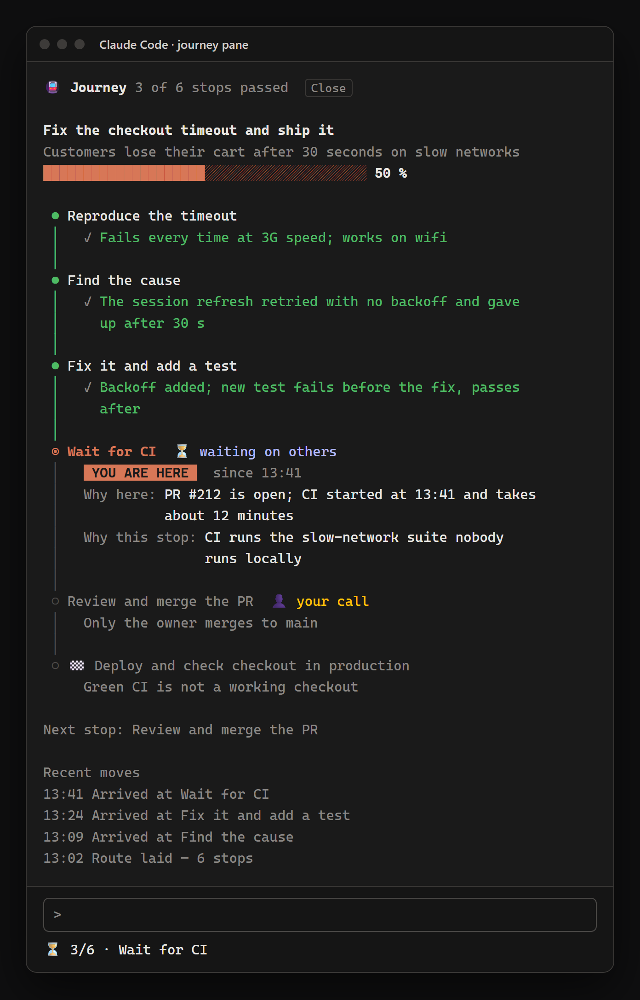

# mods

**English** · [العربية](README.ar.md)

Ahmed's mods for Claude Code, published as a plugin marketplace.

| Mod | What it does |
|---|---|
| [journey](journey/README.md) | A metro line for the task in hand: every stop from here to done, which stop the session is at, and why — drawn in a pane and pinned in the status line. |

<p align="center"></p>

## Install

```
claude plugin marketplace add AhmedQureshi89/mods
claude plugin install journey@ahmed-mods
```

## License

MIT — see [LICENSE](LICENSE).
